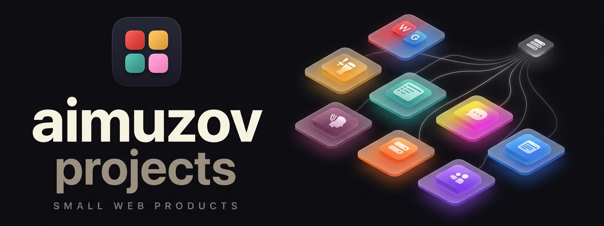
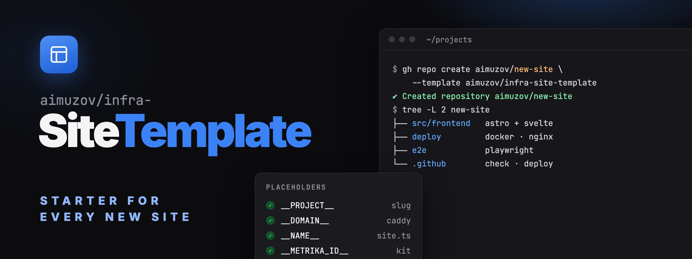

	
	

	

<b>Small web products by <a href="https://github.com/aimuzov">Aleksey Imuzov</a></b>

Static Astro sites with Svelte islands, a tiny Node API or a Telegram bot, each in its own Docker Compose behind a shared Caddy

	
	
	
	
	
	

## Projects

<table>
	<tr>
		<td width="50%" valign="top">
			
			<h3><a href="https://github.com/aimuzov/codenames">Codenames</a></h3>
			
Offline party word game: one phone on the table, a room code, or phone-to-phone over WebRTC

			

				
				
			

		</td>
		<td width="50%" valign="top">
			
			<h3><a href="https://github.com/aimuzov/community-taplist">Taplist</a></h3>
			
Digital tap board for a craft beer bar, with an editor for the staff

			

				
				
			

		</td>
	</tr>
	<tr>
		<td width="50%" valign="top">
			
			<h3><a href="https://github.com/aimuzov/prestige-logist">Prestige Logist</a></h3>
			
Forwarding order (KND 1110486) to carriage request (KND 1110361) for Diadoc and Kontur.Logistika

			

				
				
			

		</td>
		<td width="50%" valign="top">
			
			<h3><a href="https://github.com/aimuzov/shkatova-psychologist">Tatiana Shkatova</a></h3>
			
Perinatal psychologist’s site with an AI assistant that prepares the first session

			

				
				
			

		</td>
	</tr>
	<tr>
		<td width="50%" valign="top">
			
			<h3><a href="https://github.com/aimuzov/sublya">Sublya</a></h3>
			
Telegram bot that burns TikTok-style subtitles into a video, the spoken word lit up, plus its landing page

			

				
				
				
			

		</td>
		<td width="50%" valign="top">
			
			<h3><a href="https://github.com/aimuzov/sorebody">Sorebody</a></h3>
			
Sports pain reference: how common each pain is in CrossFit, padel, football, running, basketball and hiking, when to see a doctor and how to adapt training

			

				
				
			

		</td>
	</tr>
</table>

## lazyvimx

A Neovim distribution in its own <a href="https://github.com/lazyvimx">lazyvimx</a> organization. Its docs site runs on the same server and stack as the projects above.

<table>
	<tr>
		<td width="50%" valign="top">
			
			<h3><a href="https://github.com/lazyvimx/nvim">lazyvimx</a></h3>
			
An enhancement layer on top of LazyVim: optional extras and plugin overrides, Russian keyboard layout included

			

				
				
			

		</td>
		<td width="50%" valign="top">
			
			<h3><a href="https://github.com/lazyvimx/site">lazyvimx docs</a></h3>
			
Documentation site in English and Russian dressed up as Neovim: statusline, vim keys, a tutor and search

			

				
				
			

		</td>
	</tr>
</table>

## MCP servers

Servers that give Claude and other MCP clients tools of my own. Two of them also run as hosted connectors on the same server as the sites, with sign-in over OAuth.

<table>
	<tr>
		<td width="50%" valign="top">
			<h3><a href="https://github.com/aimuzov/thinks-mcp">thinks-mcp</a></h3>
			
Writes, replies and rephrases in your own voice, learned from a Telegram export and your git history: Claude gets a measured style profile and your real messages, with no API keys and no generation of its own

			

				
				
				
			

		</td>
		<td width="50%" valign="top">
			<h3><a href="https://github.com/aimuzov/kaiten-mcp">kaiten-mcp</a></h3>
			
Kaiten from any MCP client: spaces, boards, cards, comments, checklists, time tracking and day planning

			

				
				
				
			

		</td>
	</tr>
	<tr>
		<td width="50%" valign="top">
			<h3><a href="https://github.com/aimuzov/veo-mcp">veo-mcp</a></h3>
			
Google Veo video generation through the Gemini API: text-to-video and image-to-video, MP4 files on disk

			

				
				
			

		</td>
		<td width="50%" valign="top">
			<h3><a href="https://github.com/aimuzov/zen-money-mcp">zen-money-mcp</a></h3>
			
ZenMoney: audits and fixes transaction categories against their history, imports missing transactions from bank statements

			

				
				
			

		</td>
	</tr>
</table>

## macOS

A desktop app of its own, in Swift, apart from the web stack above.

<table>
	<tr>
		<td width="50%" valign="top">
			
			<h3><a href="https://github.com/aimuzov/kumiko">kumiko</a></h3>
			
A tiling window manager for macOS in one app: workspaces, hotkeys and modes, a bar, a frame around the focused window and Vim in text fields, all set up from a settings window

			

				
				
			

		</td>
		<td width="50%" valign="top"></td>
	</tr>
</table>

## Infrastructure

<table>
	<tr>
		<td width="50%" valign="top">
			
			<h3><a href="https://github.com/aimuzov/infra-site-kit">infra-site-kit</a></h3>
			
What every site shares: the <code>check</code>, <code>release</code> and <code>deploy</code> actions, Prettier, Stylelint, oxlint and Playwright configs, the author credit, the theme peek and Yandex Metrika.

			

				
				
			

		</td>
		<td width="50%" valign="top">
			
			<h3><a href="https://github.com/aimuzov/infra-server">infra-server</a></h3>
			
Shared Caddy for the projects server: owns 80/443, issues certificates and routes each domain to its project’s containers. Plus an Xray egress for the APIs unreachable from Russia.

			

		</td>
	</tr>
	<tr>
		<td width="50%" valign="top">
			
			<h3><a href="https://github.com/aimuzov/infra-site-template">infra-site-template</a></h3>
			
The template every new site starts from: Astro with Svelte, unit tests on <code>node --test</code> and Playwright e2e, check and deploy workflows on top of infra-site-kit, Docker and nginx in <code>deploy/</code>, room for an API in <code>src/backend</code>.

			

		</td>
		<td width="50%" valign="top">
			
			<h3><a href="https://github.com/aimuzov/infra-mcp-template">infra-mcp-template</a></h3>
			
The template every new MCP server starts from: stdio and a hosted OAuth connector on infra-mcp-kit, Astro pages with Svelte islands, check and release workflows, npm publishing, Docker in <code>deploy/</code>.

			

		</td>
	</tr>
	<tr>
		<td width="50%" valign="top">
			
			<h3><a href="https://github.com/aimuzov/infra-mcp-kit">infra-mcp-kit</a></h3>
			
What every MCP server shares: the stdio core, the hosted OAuth connector, Astro pages and test helpers, plus the <code>check</code> and <code>publish</code> actions.

			

				
				
			

		</td>
		<td width="50%" valign="top"></td>
	</tr>
</table>

A merge of the release PR from release-please → GitHub Actions with the infra-site-kit deploy → SSH → <code>docker compose up</code> on the server → Caddy serves it over HTTPS.

