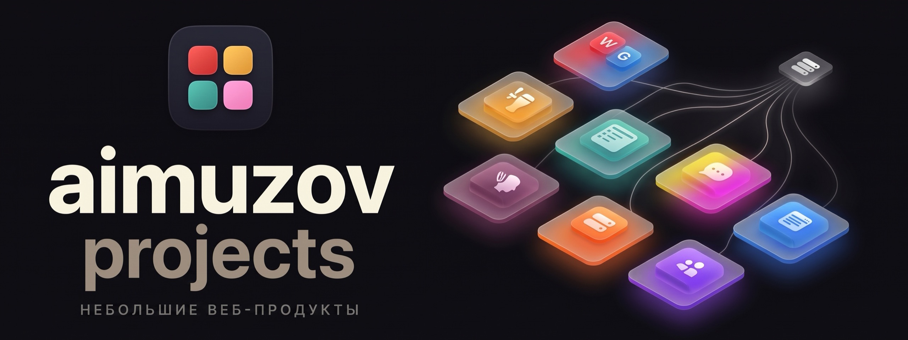
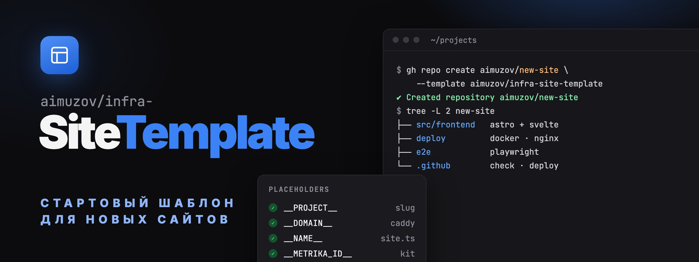

	
	

	

<b>Небольшие веб-продукты <a href="https://github.com/aimuzov">Алексея Имузова</a></b>

Статичные сайты на Astro с островами на Svelte, маленьким Node-API или Telegram-ботом, каждый в своём Docker Compose за общим Caddy

	
	
	
	
	
	

## Проекты

<table>
	<tr>
		<td width="50%" valign="top">
			
			<h3><a href="https://github.com/aimuzov/codenames">Codenames</a></h3>
			
Игра в слова для компании: один телефон на столе, телефон к телефону через WebRTC или онлайн-комната по коду с голосовым чатом

			

				
				
			

		</td>
		<td width="50%" valign="top">
			
			<h3><a href="https://github.com/aimuzov/community-taplist">Taplist</a></h3>
			
Цифровая доска кранов для крафтового бара с редактором для персонала

			

				
				
			

		</td>
	</tr>
	<tr>
		<td width="50%" valign="top">
			
			<h3><a href="https://github.com/aimuzov/prestige-logist">Престиж Логист</a></h3>
			
Поручение экспедитору (КНД 1110486) → заявка на перевозку (КНД 1110361) для Диадока и Контур.Логистики

			

				
				
			

		</td>
		<td width="50%" valign="top">
			
			<h3><a href="https://github.com/aimuzov/shkatova-psychologist">Татьяна Шкатова</a></h3>
			
Сайт перинатального психолога с ИИ-ассистентом для подготовки к первой встрече

			

				
				
			

		</td>
	</tr>
	<tr>
		<td width="50%" valign="top">
			
			<h3><a href="https://github.com/aimuzov/sublya">Сабля</a></h3>
			
Telegram-бот, который вшивает в видео субтитры в стиле TikTok с подсветкой произносимого слова, и его лендинг

			

				
				
				
			

		</td>
		<td width="50%" valign="top">
			
			<h3><a href="https://github.com/aimuzov/sorebody">Sorebody</a></h3>
			
Справочник спортивной боли: как часто она бывает в кроссфите, паделе, футболе, беге, баскетболе и хайкинге, когда идти к врачу и как адаптировать тренировки

			

				
				
			

		</td>
	</tr>
</table>

## lazyvimx

Дистрибутив Neovim в своей организации <a href="https://github.com/lazyvimx">lazyvimx</a>. Сайт документации живёт на том же сервере и стеке, что и проекты выше.

<table>
	<tr>
		<td width="50%" valign="top">
			
			<h3><a href="https://github.com/lazyvimx/nvim">lazyvimx</a></h3>
			
Слой улучшений поверх LazyVim: опциональные экстры и оверрайды плагинов, русская раскладка в комплекте

			

				
				
			

		</td>
		<td width="50%" valign="top">
			
			<h3><a href="https://github.com/lazyvimx/site">Документация lazyvimx</a></h3>
			
Сайт документации на русском и английском в обличье Neovim: статуслайн, vim-клавиши, туториал и поиск

			

				
				
			

		</td>
	</tr>
</table>

## MCP-серверы

Серверы, которые дают Claude и другим MCP-клиентам мои собственные инструменты. Два из них ещё и работают как размещённые коннекторы на том же сервере, что и сайты, со входом по OAuth.

<table>
	<tr>
		<td width="50%" valign="top">
			
			<h3><a href="https://github.com/aimuzov/thinks-mcp">thinks-mcp</a></h3>
			
Пишет, отвечает и перефразирует твоим голосом, выученным по выгрузке Telegram и истории git: Claude получает замеренный стиль-профиль и твои настоящие сообщения, без API-ключей и без собственной генерации

			

				
				
				
			

		</td>
		<td width="50%" valign="top">
			
			<h3><a href="https://github.com/aimuzov/kaiten-mcp">kaiten-mcp</a></h3>
			
Kaiten из любого MCP-клиента: пространства, доски, карточки, комментарии, чек-листы, учёт времени и планирование дня

			

				
				
				
			

		</td>
	</tr>
	<tr>
		<td width="50%" valign="top">
			
			<h3><a href="https://github.com/aimuzov/veo-mcp">veo-mcp</a></h3>
			
Генерация видео в Google Veo через Gemini API: из текста и из картинки, MP4-файлы на диске

			

				
				
			

		</td>
		<td width="50%" valign="top">
			
			<h3><a href="https://github.com/aimuzov/zen-money-mcp">zen-money-mcp</a></h3>
			
ZenMoney: проверяет и исправляет категории операций с оглядкой на историю, импортирует недостающие операции из банковских выписок

			

				
				
			

		</td>
	</tr>
</table>

## macOS

Отдельное приложение для Мака на Swift, в стороне от веб-стека выше.

<table>
	<tr>
		<td width="50%" valign="top">
			
			<h3><a href="https://github.com/aimuzov/kumiko">kumiko</a></h3>
			
Тайлинговый менеджер окон для macOS одним приложением: рабочие столы, хоткеи и режимы, бар, рамка вокруг окна в фокусе и Vim в текстовых полях, и всё это настраивается в окне настроек

			

				
				
				
			

		</td>
		<td width="50%" valign="top">
			
			<h3><a href="https://github.com/aimuzov/kumiko-site">kumiko-site</a></h3>
			
Лендинг kumiko: рабочий стол, который слушается клавиш kumiko, шесть утилит, слетающихся в одну иконку, окна, встающие плиткой в финале, и ченжлог каждого релиза

			

				
				
			

		</td>
	</tr>
</table>

## Командная строка

Небольшие инструменты для терминала: нативная fish-функция и её близнец на POSIX sh для остальных shell.

<table>
	<tr>
		<td width="50%" valign="top">
			
			<h3><a href="https://github.com/aimuzov/claude-export">claude-export</a></h3>
			
Превращает экспорт данных claude.ai в папку на диске: открывает каждую ссылку на архив в браузере, ждёт загрузку, проверяет zip и раскладывает по категориям

			

		</td>
		<td width="50%" valign="top"></td>
	</tr>
</table>

## Инфраструктура

<table>
	<tr>
		<td width="50%" valign="top">
			
			<h3><a href="https://github.com/aimuzov/infra-site-kit">infra-site-kit</a></h3>
			
Всё общее для сайтов: экшены <code>check</code>, <code>release</code> и <code>deploy</code>, конфиги Prettier, Stylelint, oxlint и Playwright, два языка, UI-компоненты, подсмотр темы, страница 404, подпись автора, Яндекс Метрика и ченжлог для читателя, который ведут и приложения вроде kumiko.

			

				
				
			

		</td>
		<td width="50%" valign="top">
			
			<h3><a href="https://github.com/aimuzov/infra-server">infra-server</a></h3>
			
Общий Caddy сервера с проектами: держит 80/443, выпускает сертификаты и направляет каждый домен в контейнеры своего проекта. Плюс выход через Xray для API, недоступных из России.

			

		</td>
	</tr>
	<tr>
		<td width="50%" valign="top">
			
			<h3><a href="https://github.com/aimuzov/infra-site-template">infra-site-template</a></h3>
			
Шаблон, с которого начинается каждый новый сайт: Astro со Svelte, юнит-тесты на <code>node --test</code> и e2e на Playwright, воркфлоу проверок и деплоя поверх infra-site-kit, Docker и nginx в <code>deploy/</code>, место под API в <code>src/backend</code>.

			

		</td>
		<td width="50%" valign="top">
			
			<h3><a href="https://github.com/aimuzov/infra-mcp-template">infra-mcp-template</a></h3>
			
Шаблон, с которого начинается каждый новый MCP-сервер: stdio и размещённый коннектор с OAuth на infra-mcp-kit, страницы на Astro с островами на Svelte, воркфлоу проверок и релиза, публикация в npm, Docker в <code>deploy/</code>.

			

		</td>
	</tr>
	<tr>
		<td width="50%" valign="top">
			
			<h3><a href="https://github.com/aimuzov/infra-mcp-kit">infra-mcp-kit</a></h3>
			
Всё общее для MCP-серверов: ядро для stdio, размещённый коннектор с OAuth, страницы на Astro и тестовые хелперы, плюс экшены <code>check</code> и <code>publish</code>.

			

				
				
			

		</td>
		<td width="50%" valign="top"></td>
	</tr>
</table>

Мёрж релизного PR от release-please → GitHub Actions с деплоем из infra-site-kit → SSH → <code>docker compose up</code> на сервере → Caddy отдаёт по HTTPS.

